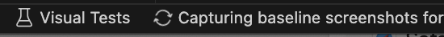
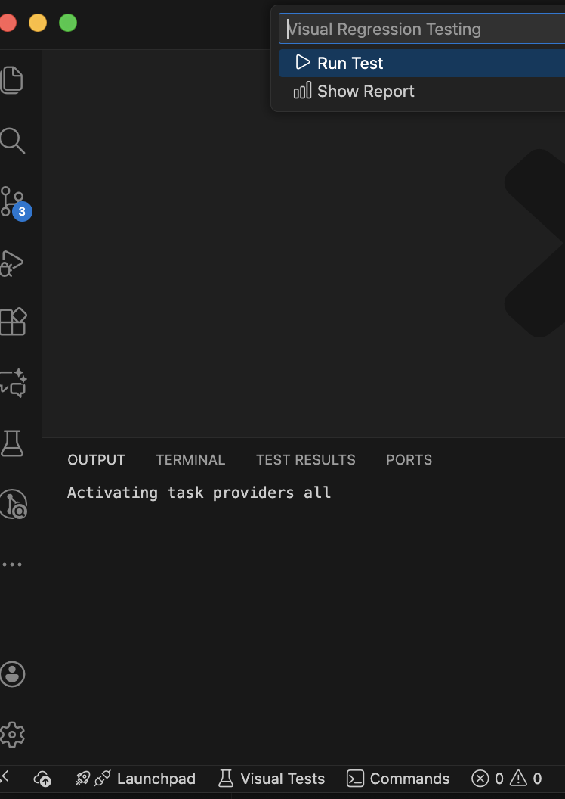
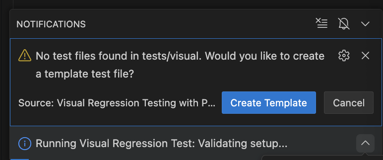

# Visual Regression Testing

Automate visual regression testing for your web applications. Compare feature branch changes against main branch baselines automatically.

## Demo

<div align="center">
  <video src="images/visual-regression-testing-vscode-extension.mp4" controls width="50%"></video>
</div>

[images/visual-regression-testing-vscode-extension.mp4](images/visual-regression-testing-vscode-extension.mp4)

## Features

- 📱 **Side panel interface** - Dedicated panel in the Activity Bar for easy access to all testing features
- 💾 **Saved URL sets** - Save and manage URL sets for repeated testing workflows
- ⚠️ **Smart warnings** - Alerts for uncommitted changes and unsaved test set modifications before running tests
- 🔒 **Branch protection** - Visual warning when on main branch to prevent accidental test runs
- 📦 **Persistent snapshot storage** - Automatically saves baseline and comparison snapshots for later review
- 📋 **Configuration display** - View current settings at a glance in the panel
- 🎯 **Automatic baseline comparison** - Captures main branch screenshots and compares with your feature branch
- 🔄 **Smart branch switching** - Handles all Git operations automatically
- 🚀 **Zero configuration** - Works with your existing Playwright setup
- 📊 **HTML reports** - Side-by-side comparison of changes with interactive slider
- 🌍 **Environment variables** - Pass custom variables for auth bypass and more
- ⚡ **Multiple URL testing** - Test several routes in one run
- 📍 **Status bar integration** - Quick access to tests and reports from the status bar (optional)

## Installation

### From Pre-Built VSIX (Quickest)

Pre-built VSIX files are available in the [`install/`](./install/) folder:

1. Download the latest `.vsix` file from the [`install/`](./install/) folder
2. In VS Code, open Command Palette (`Ctrl+Shift+P` / `Cmd+Shift+P`)
3. Select `Extensions: Install from VSIX...`
4. Choose the downloaded `.vsix` file
5. Reload VS Code

See [install/README.md](./install/README.md) for details.

### Build from Source

**Quick Method (Build & Install):**

```bash
npm run build-install
```

This automatically:
1. Builds the extension with webpack
2. Cleans the `install/` folder
3. Generates the VSIX package
4. Copies it to `install/` for distribution

**Manual Method:**

```bash
npm install
npm run package
npm run vsce-package
```

Then manually copy the `.vsix` file to the `install/` folder.

### Project Setup

Ensure Playwright is installed in your project:

```bash
npm install -D @playwright/test && npx playwright install
```

📚 **New to this extension?** Check out the [Complete Getting Started Guide](GETTING-STARTED.md) for a step-by-step tutorial.

## Testing the Extension

### Test the Extension During Development

1. **Prepare dependencies:**
   ```bash
   npm install
   ```

2. **Compile TypeScript:**
   ```bash
   npm run compile
   ```

3. **Launch the Extension Development Host:**
   - Press `F5` in VS Code
   - This opens a new VS Code window running your extension in development mode

4. **Test the Extension:**
   - In the development window, click the camera icon (📷) in the left activity bar
   - Open the Visual Regression Testing sidebar panel
   - Configure settings in `.vscode/settings.json`:
     ```json
     {
       "visualRegression.testPath": "tests/visual",
       "visualRegression.serverStartCommand": "npm run dev",
       "visualRegression.serverPort": 3000,
       "visualRegression.mainBranch": "main"
     }
     ```
   - Click "▶ Run Test" to execute visual regression testing
   - Verify baseline and comparison snapshots are created
   - Check that reports generate correctly

5. **Debug:**
   - Set breakpoints in TypeScript files
   - Open Developer Tools: `Help > Toggle Developer Tools`
   - Check Output panel: `View > Output > Visual Regression Testing`

### Run Unit Tests

```bash
npm test
```

### Watch Mode (Auto-Compile)

```bash
npm run watch
```

While watch mode is running, code changes automatically recompile. Simply reload the extension window (`Cmd+R` / `Ctrl+R`) to test changes.

## Quick Start

### 1. Create Test File

Create `tests/visual/pages.spec.ts`:

```typescript
import { test, expect } from '@playwright/test';

// Get URLs from environment (comma-separated for multiple URLs)
const testUrls = process.env.TEST_URLS 
  ? process.env.TEST_URLS.split(',')
  : [process.env.TEST_URL || 'http://localhost:3000/'\]\;

// Generate a test for each URL
for (const testUrl of testUrls) {
  test(\`visual test for \${testUrl}\`, async ({ page }) => {
    await page.goto(testUrl);
    await page.waitForLoadState('networkidle');

    // Generate unique filename from URL path
    const urlPath = new URL(testUrl).pathname;
    const filename = urlPath
      .replace(/^\//, '')
      .replaceAll('/', '-')
      .replaceAll(/[^a-zA-Z0-9-_]/g, '_')
      || 'homepage';

    await expect(page).toHaveScreenshot(\`\${filename}.png\`, { fullPage: true });
  });
}
```

### 2. Configure Settings

Add to `.vscode/settings.json`:

```json
{
  "visualRegression.testPath": "tests/visual",
  "visualRegression.serverStartCommand": "npm run dev",
  "visualRegression.serverPort": 3000,
  "visualRegression.mainBranch": "main",
  "visualRegression.testImportPath": "../path-to-custom-fixtures",
  "visualRegression.waitForSelector": "selector-rule-to-show-page-has-loaded",
  "visualRegression.environmentVariables": {
    "NEXT_PUBLIC_PLAYWRIGHT": "true"
  }
}
```

### 3. Run Test

**Option 1: Using Side Panel** ⭐ Recommended
1. Click the camera icon (📷) in the Activity Bar (left sidebar)
2. Enter URL paths in the text field (one per line):
   ```
   /
   /about
   /contact
   ```
3. Click "▶ Run Test"
4. The panel shows your current branch, configuration, and test progress
5. Save frequently-used URL sets for quick re-testing

**Option 2: Using Command Palette**
1. Open Command Palette (\`Cmd+Shift+P\`)
2. Type "Visual Regression: Run Test"
3. Enter URL paths (comma-separated for multiple): \`/,/unauthorised,/access-denied\`

**Option 3: Using Status Bar**
1. Click the "Visual Tests" item in the status bar (bottom left)
2. Select "Run Test" or "Show Report" from the menu





## How It Works

1. **Safety checks** - Warns about unsaved test set modifications and when you are on the main branch
2. **Resolves main** - Finds the commit of your main branch (local branch, or `origin/<main>` if there is no local one). You stay on your current branch; your working tree is never touched
3. **Uses the cached baseline, or captures it** - Baseline screenshots are cached by main's commit, URLs, environment variables and test files. On a cache miss, the baseline is captured from a separate git worktree of main (in `.visual-regression-snapshots/baseline-worktree/`) running on its own port
4. **Starts your dev server** - Boots in parallel with the baseline preparation, or reuses the server already running on `serverPort`. The extension waits until the server responds rather than sleeping for a fixed time
5. **Runs comparison** - Compares new screenshots against the baseline
6. **Saves comparison** - Stores comparison results to `.visual-regression-snapshots/comparison/`
7. **Shows HTML report** - Opens interactive report if differences are found

Each step is timed in the **Visual Regression Test** output channel.

> Prefer the old behaviour (check out main in your working tree, capture, switch back)? Set `visualRegression.baselineStrategy` to `checkout`.

### Persistent Snapshot Storage

The most recent test results are automatically saved to `.visual-regression-snapshots/` (gitignored):
- **Baseline cache**: `.visual-regression-snapshots/baseline-cache/<main-sha>-<hash>/`
  - Contains the baseline screenshots from the main branch (the five most recent are kept)
  - Reused until main, the URLs, the environment variables or the test files change
  - The `baseline/` folder from earlier versions is only written when `baselineStrategy` is `checkout`

- **Comparison snapshots**: `.visual-regression-snapshots/comparison/`
  - Contains screenshots from your feature branch
  - Includes the `.spec.ts-snapshots/` directory with expected images
  - Includes `test-results/` with actual, expected, and diff images (when differences are found)
  - Includes the complete Playwright HTML report for interactive comparison

Previous comparison results are replaced on each run, and old baseline caches are pruned automatically. You can open the saved `playwright-report/index.html` in any browser to review the comparison with the interactive slider.

## Configuration

| Setting | Default | Description |
|---------|---------|-------------|
| \`testPath\` | \`tests/visual\` | Path to Playwright test files |
| \`mainBranch\` | \`main\` | Main branch name |
| \`serverStartCommand\` | \`npm run dev\` | Command to start dev server. Use \`{port}\` for the port (\`PORT\` env var is also set) |
| \`serverPort\` | \`3000\` | Dev server port |
| \`serverStartupTimeout\` | \`60000\` | Max time to wait for a dev server to respond (ms). Replaces \`serverStartupTime\` |
| \`baselineStrategy\` | \`worktree\` | \`worktree\` captures the baseline from a separate git worktree (working tree untouched); \`checkout\` is the legacy branch-switching flow |
| \`cacheBaseline\` | \`true\` | Reuse baseline screenshots until main, the URLs or the tests change |
| \`environmentVariables\` | \`{}\` | Custom environment variables |
| \`testImportPath\` | \`@playwright/test\` | Import path for test fixtures |
| \`waitForSelector\` | \`""\` | Optional CSS selector to wait for before taking screenshots |
| \`showStatusBar\` | \`true\` | Show/hide status bar item |
| \`notifyOnCompletion\` | \`true\` | Show notification when tests complete |
| \`autoRunOnSave\` | \`false\` | Automatically run tests when files are saved |
| \`autoRunDelay\` | \`2000\` | Delay before auto-running tests (ms) |

### Environment Variables

Pass variables to bypass auth or enable mocking:

```json
{
  "visualRegression.environmentVariables": {
    "NEXT_PUBLIC_PLAYWRIGHT": "true",
    "API_MOCKING": "enabled"
  }
}
```

## Auth Bypass Example (Next.js)

In your middleware:

```typescript
export function middleware(request: NextRequest) {
  if (process.env.NEXT_PUBLIC_PLAYWRIGHT === 'true') {
    return NextResponse.next();
  }
  // Normal auth flow...
}
```

## Migrating to 1.12

Most setups need no changes. The baseline is now captured from a separate git worktree (your branch and uncommitted changes are never touched) and cached, and servers are polled for readiness instead of sleeping. Check the following:

### 1. Use `{port}` in `serverStartCommand` (most likely change)

The baseline server runs alongside your dev server on a different port (the next free port after `serverPort`), so the start command must not hardcode one. The extension substitutes `{port}` and also sets the `PORT` environment variable.

| Your dev server | `serverStartCommand` |
|---|---|
| Next.js | `npm run dev -- -p {port}` (or leave as `npm run dev`; Next honours `PORT`) |
| Vite | `npm run dev -- --port {port}` |
| Create React App / most Node servers | `npm run dev` (they honour `PORT`) |
| Hardcoded in the script (e.g. `next dev -p 3000`) | Change the script to `next dev` or call the binary directly: `npx next dev -p {port}` |

If you skip this, the first run (when the baseline isn't cached) fails with *"Dev server did not respond on port ..."* and shows the server's output.

### 2. Rename `serverStartupTime` to `serverStartupTimeout`

`serverStartupTime` (default 5000) is deprecated and ignored. The extension now continues as soon as the server responds; `serverStartupTimeout` (default `60000`) is only the maximum wait. Delete the old setting, and raise the new one only if your server needs more than 60 seconds.

### 3. Things the baseline worktree does not have

The worktree is a clean checkout of main. The extension copies in `node_modules` (symlinked), `.env*` files, your test directory and `playwright.config.*`. If your dev server needs other untracked files (generated code, a local `.npmrc`, certificates...) they will be missing in the baseline. Either commit them, or set `visualRegression.baselineStrategy` to `checkout`.

If main's dependencies differ a lot from your branch's, the baseline still runs against your current `node_modules`. Use `checkout` mode in that case too.

### 4. Other behaviour changes

- **Main branch name**: `mainBranch` is resolved as a local branch, falling back to `origin/<mainBranch>`.
- **Already-running server**: a dev server on `serverPort` is reused (and never stopped by the extension) instead of causing a "port in use" error. Make sure it is running your current branch.
- **Saved snapshots**: `.visual-regression-snapshots/baseline/` is no longer written; see *Persistent Snapshot Storage*. The folder is added to `.git/info/exclude` automatically.
- **No more uncommitted-changes risk**: the extension no longer runs `git checkout -f`, so switching branches mid-run can't discard work.
- **New settings**: `baselineStrategy` (`worktree` | `checkout`), `cacheBaseline` (default `true`), `serverStartupTimeout`.

### Reverting to the old behaviour

```json
{
  "visualRegression.baselineStrategy": "checkout",
  "visualRegression.cacheBaseline": false
}
```

## Troubleshooting

### Test file not found
Create \`tests/visual/pages.spec.ts\` with the template above.



### Playwright not installed
```bash
npm install -D @playwright/test && npx playwright install
```

### Not a Git repository
```bash
git init
```

### Auth redirects
Add environment variables to bypass auth (see Auth Bypass Example above).

### Server timeout
Increase \`serverStartupTimeout\` in settings (default 60000 ms). Make sure \`serverStartCommand\` uses \`{port}\` (or honours the \`PORT\` env var) so the baseline server can run on a second port.

### Port already in use
If a server is already answering on \`serverPort\`, it is reused. For the baseline, the extension picks the next free port after \`serverPort\`; if your start command hardcodes a port, see [Migrating to 1.12](#migrating-to-112).

### No visual differences detected
Expected if your changes don't affect visual appearance.

### Not seeing notifications
VS Code notifications appear in the bottom right corner. If you missed them:
1. Click the bell icon (🔔) in the bottom right status bar
2. Or check **View → Notifications** to see recent notifications
3. Alternatively, check the Output panel for detailed logs

### Disable Playwright Test UI
1. Open Settings (\`Cmd+,\`)
2. Search "Playwright"
3. Uncheck "Playwright: Show Test Explorer"

### Hide/Show Status Bar
The extension adds a "Visual Tests" item to the status bar for quick access. To hide it:
1. Open Settings (\`Cmd+,\`)
2. Search "Visual Regression: Show Status Bar"
3. Uncheck to hide, or check to show
4. Changes apply immediately - no reload required

### View logs
1. Open Output panel: \`View → Output\`
2. Select "Visual Regression Testing"

### Reviewing saved snapshots
After running tests, you can review both baseline and comparison snapshots:
1. Navigate to `.visual-regression-snapshots/` in your workspace
2. You'll find two directories:
   - `baseline/` - Contains main branch screenshots and Playwright report
   - `comparison/` - Contains feature branch screenshots, diff images, and Playwright report
3. **Open the saved HTML report**: Navigate to either directory and open `playwright-report/index.html` in your browser for the full interactive comparison with the slider
4. **Browse images directly**: Look in the `comparison/test-results/` folder for actual, expected, and diff PNG files
5. Snapshot directories are automatically gitignored and cleaned up with each new test run

## Using the Side Panel

### Accessing the Panel
Click the camera icon (📷) in the Activity Bar to open the Visual Regression Testing panel.

### Panel Features

**Branch Warning**
- Shows a warning when you're on the main/base branch
- Prevents accidental test runs on the baseline branch

**Configuration Display**
- Current Branch
- Main Branch
- Server Port
- Test Path

**URL Input**
- Enter multiple URLs (one per line)
- URLs are automatically formatted
- Persists between sessions

**Saved URL Sets**
- Save frequently-used URL combinations with a name
- Quickly re-run saved test sets
- Edit/Load URLs from saved sets
- Delete sets you no longer need
- **Auto-save prompt**: When running tests with unsaved changes to a loaded set, you'll be prompted to save

**Safety Warnings**
- **Uncommitted changes**: Warns if you have uncommitted changes (excluding `page.spec.ts`) before running tests
- **Unsaved test set changes**: Detects modifications to loaded test sets and offers to save before running
- Options: Save Changes, Run Anyway, or Cancel

**Test Actions**
- Run Test: Execute visual regression test with current URLs
- Show Report: Open the latest Playwright HTML report
- Running banner replaces buttons during test execution

## Commands

All features are accessible via the side panel, command palette, or status bar:

- **Run Test** - Test one or more URLs
- **Run Full Workflow** - Complete test workflow
- **Run Tests for Changed Pages** - Test only modified pages
- **Run Test for Single Page** - Test a specific page
- **Update Baselines** - Update baseline screenshots
- **Show Playwright Report** - View latest test report
- **Clean Snapshots** - Remove temporary snapshots

## Requirements

- Node.js 16+
- Git repository
- Playwright (\`@playwright/test\`)
- Dev server command

